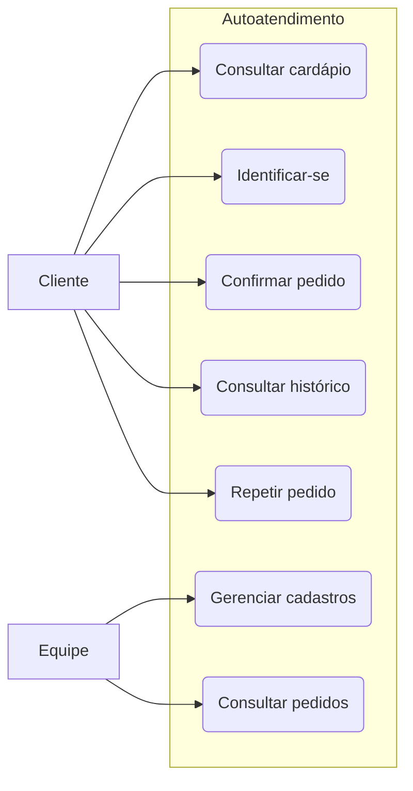
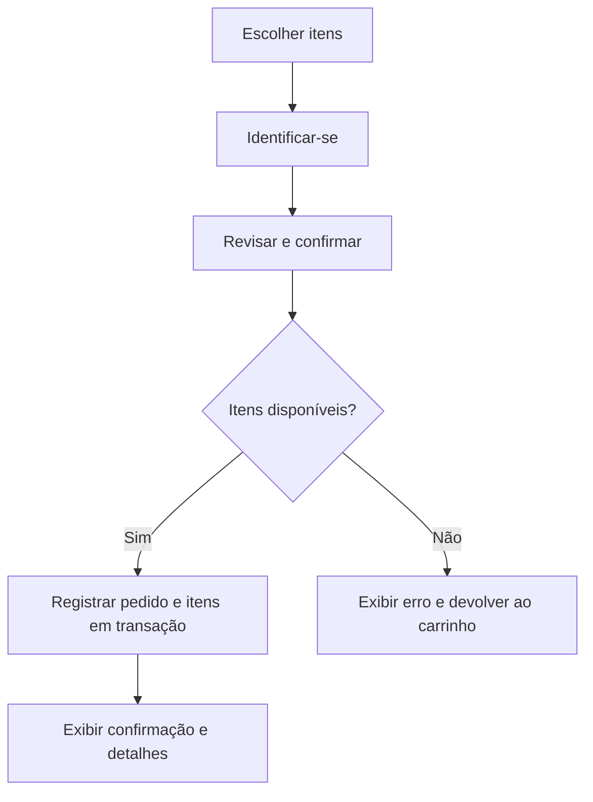
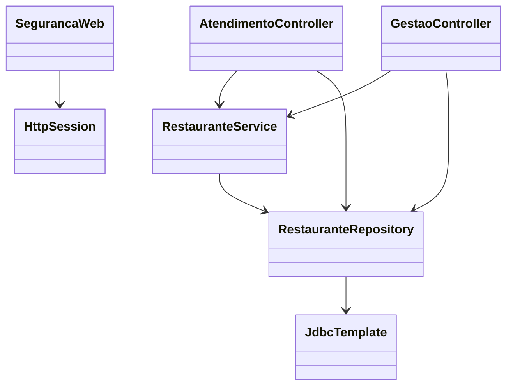
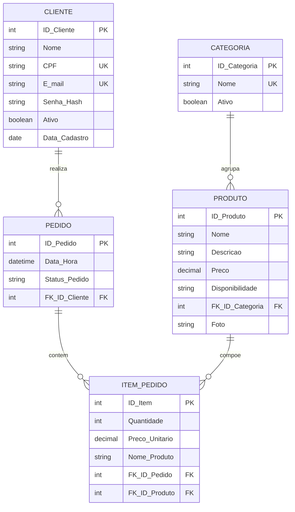

# Sistema de automação para terminais de autoatendimento

**Instituto Federal de São Paulo · Campus São Paulo**  
Bacharelado em Sistemas de Informação · SPOBDD1 · 2026  
Professor Francisco Veríssimo Luciano  
Guilherme Campelo de Souza, Arthur Gomes Almeida e Martin Tenorio De Arruda

## Resumo

O Brasa de Rua registra pedidos de um restaurante e associa cada compra a um cliente autenticado. O cliente pode consultar compras anteriores e usar seus itens para iniciar um novo pedido. A equipe mantém o cardápio e consulta pedidos. A persistência em SQL Server garante relacionamentos válidos e mantém o preço de cada item na data da compra.

**Palavras-chave** · autoatendimento, banco de dados, histórico de pedidos.

## Sumário

1. [Introdução e objetivos](#introdução-e-objetivos)
2. [Arquitetura](#arquitetura)
3. [Requisitos](#requisitos)
4. [Projeto de software](#projeto-de-software)
5. [Projeto de banco de dados](#projeto-de-banco-de-dados)
6. [Testes e implantação](#testes-e-implantação)
7. [Proposta comercial](#proposta-comercial)
8. [Considerações finais e referências](#considerações-finais-e-referências)

### Índice de figuras

1. Casos de uso.
2. Fluxo de confirmação do pedido.
3. Classes da aplicação.
4. Modelo lógico relacional.

### Índice de tabelas

1. Requisitos e implementação.
2. Casos de uso.
3. Cenários de teste.
4. Cronograma estimado.

### Siglas

CRUD (cadastro, consulta, alteração e exclusão), JDBC (Java Database Connectivity), MVC (Model–View–Controller), SQL (Structured Query Language).

## Introdução e objetivos

O atendimento convencional registra a compra, mas nem sempre disponibiliza a informação para o cliente quando ele retorna. A proposta é organizar o cardápio e o histórico em um sistema web responsivo com controles de toque. O objetivo geral é implementar o autoatendimento com persistência relacional. Os objetivos específicos abrangem cadastro e autenticação, registro de itens e preços, recuperação do histórico, recompra e manutenção administrativa.

## Arquitetura

O navegador envia formulários HTTP ao Spring MVC. Thymeleaf gera as páginas HTML, CSS define o layout e JavaScript coordena os filtros locais e as quantidades do carrinho. No servidor, os controllers redirecionam o fluxo e conferem a sessão. O serviço valida os dados e inicia a transação do pedido. O repositório usa Spring JDBC e o driver da Microsoft para executar T-SQL parametrizado. Maven gerencia dependências e empacota a aplicação. O README documenta a infraestrutura local e as variáveis de configuração.

## Requisitos

| Requisito | Implementação |
| --- | --- |
| RF01 a RF04 | Cadastro, consulta e edição na área de gestão. Exclusão de cadastro sem pedido e desativação com histórico. |
| RF05 a RF08 | Gestão de categorias, produtos, preços e disponibilidade. O cardápio inclui somente produtos disponíveis de categorias ativas. |
| RF09 a RF10 | Confirmação por cliente autenticado e inserção dos itens com preço e nome do momento da compra em uma transação. |
| RF11 a RF12 | Histórico e detalhes do titular. A equipe tem uma consulta administrativa. Recompra inicia um carrinho com os itens disponíveis e os preços vigentes. |
| RNF01 e RNF02 | Meta de cinco segundos em uso normal, limites de espera JDBC e índices nas chaves estrangeiras de maior uso. |
| RNF03 e RNF04 | Sessão distingue cliente e equipe. O detalhe do cliente filtra por titular. Senhas de clientes são armazenadas com BCrypt e a senha administrativa vem do ambiente. |
| RNF05 | A aplicação depende do processo Java, da rede e do serviço SQL no período de funcionamento. |
| RNF06 e RNF07 | Layout responsivo, controles de toque, confirmação, estados vazios e mensagens de erro. |

## Projeto de software

| Caso de uso | Ator | Fluxo |
| --- | --- | --- |
| Consultar cardápio | Cliente | Abre o cardápio e pode escolher uma categoria. |
| Identificar-se | Cliente | Entra com e-mail e senha ou cria conta. Dados inválidos geram mensagem de revisão. |
| Realizar pedido | Cliente | Seleciona produtos, revisa as quantidades e confirma. O sistema verifica disponibilidade, grava itens e exibe o detalhe. |
| Consultar e repetir pedido | Cliente | Abre o próprio histórico e escolhe um pedido. A recompra transfere os itens disponíveis ao carrinho. |
| Gerenciar cadastros | Equipe | Entra na gestão e cria, consulta, edita ou remove registros. Registros referenciados são desativados. |
| Consultar pedidos | Equipe | Abre a lista administrativa e consulta o detalhe de um pedido. |

### Figura 1. Casos de uso



### Figura 2. Atividade de confirmação do pedido



### Figura 3. Classes da aplicação



O projeto de interface está implementado nas telas Thymeleaf. O cardápio apresenta categorias e cards com foto, descrição e botão de inclusão. O resumo acompanha o cardápio em desktop e possui atalho fixo em celular. A conta e os detalhes usam uma coluna principal. A gestão combina listagem e formulário, com rolagem interna para tabelas em telas estreitas.

## Projeto de banco de dados

### Modelo conceitual

O cliente realiza pedidos. Um pedido confirmado contém um ou mais itens. Cada item corresponde a um produto e conserva o preço unitário e o nome da compra. Cada produto pertence a uma categoria.

### Figura 4. Modelo lógico relacional



### Modelo físico e operações

[`01-estrutura.sql`](../banco/01-estrutura.sql) cria as cinco tabelas, chaves e restrições. A função `dbo.TotalPedido` soma quantidade × preço unitário. A procedure `dbo.FinalizarPedido` exige itens e conclui somente pedidos pendentes. O trigger `dbo.ProtegerItensFinalizados` impede modificações nos itens concluídos. A view `dbo.ResumoPedido` fornece status, data e total calculado às consultas. O script [`02-cardapio.sql`](../banco/02-cardapio.sql) carrega seis produtos.

```sql
SELECT ID_Pedido, Data_Hora, Status_Pedido, Total
FROM dbo.ResumoPedido
WHERE FK_ID_Cliente = @cliente
ORDER BY ID_Pedido DESC;
```

No CRUD, o repositório fornece as operações de criação, listagem, alteração e remoção. Quando existe dependência, a remoção troca o estado do registro para preservar as chaves estrangeiras. O checkout executa INSERT do pedido, INSERT dos itens e EXEC da procedure em uma única transação.

## Testes e implantação

| Cenário | Resultado esperado |
| --- | --- |
| Abrir cardápio e filtrar bebidas | Somente produtos da categoria aparecem. |
| Cadastrar, sair e entrar novamente | O cliente acessa o histórico pela própria conta. |
| Confirmar dois itens e repetir o pedido | Pedido finalizado com os preços armazenados e recompra com os preços atuais. |
| Abrir detalhe com uma conta diferente | HTTP 404. |
| Editar e remover categoria e produto | Cadastros sem vínculos são removidos. Cadastros com vínculos ficam indisponíveis. |
| Alterar item de um pedido finalizado via SQL | O trigger rejeita a alteração. |

A validação executada usou Chrome, Java 21 e SQL Server 2022 Express. Foram verificados o cadastro, o carrinho, o pedido com dois itens, a recompra após alteração de preço, o isolamento do histórico e a desativação de registros vinculados. Quando um item ficou indisponível antes da confirmação, a operação retornou erro e o histórico permaneceu com apenas o pedido anterior. O trigger rejeitou uma alteração direta em item finalizado.

A confirmação de dois itens foi observada em 0,44 segundo no ambiente local. Um ensaio SQL com 2.000 clientes, pedidos e itens verificou a agregação dos totais em cerca de 2,25 segundos no conjunto inteiro. Os dados do ensaio de volume foram revertidos. A disponibilidade durante o horário do restaurante depende da infraestrutura de implantação.

A instalação está no [README](../README.md). Na demonstração, o cliente pode adicionar um produto antes de entrar, escolher **Confirmar pedido** e voltar pelo link **Meus pedidos**. A equipe acessa o menu administrativo no rodapé, mantém o cardápio e acompanha pedidos. Para implantação, use HTTPS, uma conta SQL com permissões da aplicação e uma rotina de backup. Disponibilidade contínua exige monitoramento no ambiente do estabelecimento.

## Proposta comercial

A solução pode ser implantada em restaurantes independentes com cardápio de balcão. A receita proposta combina implantação e suporte mensal. Como exercício acadêmico, estima-se um piloto de R$ 2.400 pela implantação e R$ 250 por mês em suporte. Os valores pressupõem uso de equipamento e rede existentes. A viabilidade deve ser confirmada no piloto comparando tempo de atendimento, taxa de uso e recorrência de compra.

| Etapa | Prazo estimado |
| --- | --- |
| Requisitos e modelos | Semana 1 |
| Banco e carga inicial | Semana 2 |
| Cardápio, sessão e pedidos | Semana 3 |
| Gestão, validação e treinamento | Semana 4 |

## Considerações finais e referências

O projeto integra a experiência do cliente e a gestão do cardápio em torno de um histórico transacional. A preservação do preço praticado permite recompras com os valores vigentes e consultas consistentes dos pedidos anteriores.

- LUCIANO, Francisco Veríssimo. *Projeto de Software. CRUD utilizando Banco de Dados*. IFSP, 2020.
- PRESSMAN, Roger S.; MAXIM, Bruce R. *Engenharia de Software. Uma abordagem profissional*. 9. ed. Porto Alegre: AMGH, 2021.
- MICROSOFT. *SQL Server documentation*. [Microsoft Learn](https://learn.microsoft.com/sql/sql-server/).
- SPRING. *JdbcTemplate*. [Spring Framework Reference](https://docs.spring.io/spring-framework/reference/data-access/jdbc/core.html).
